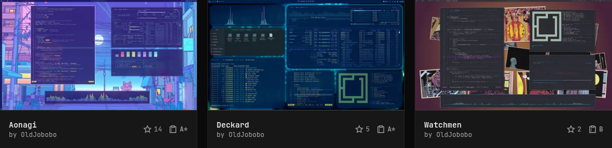
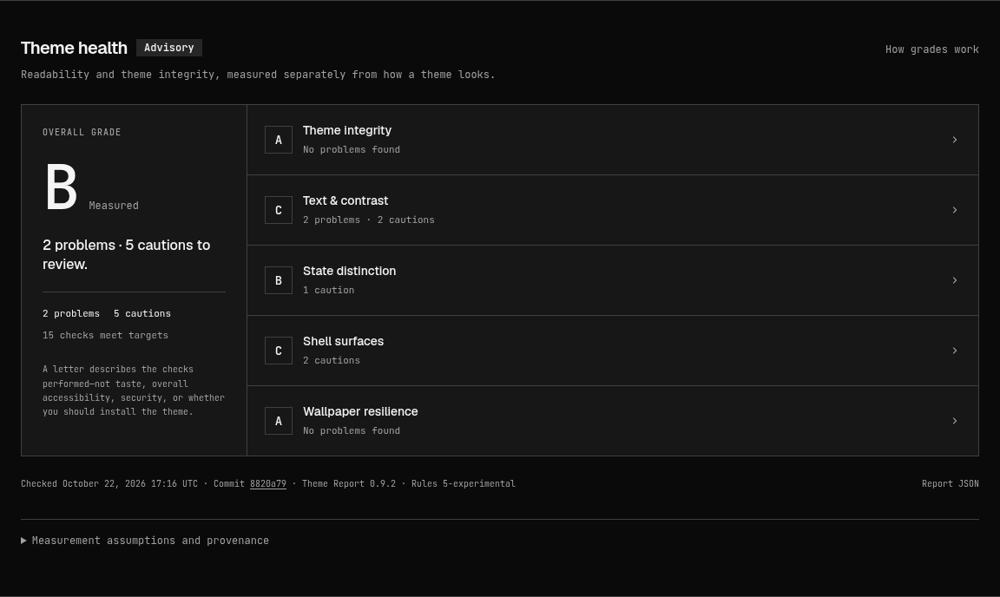
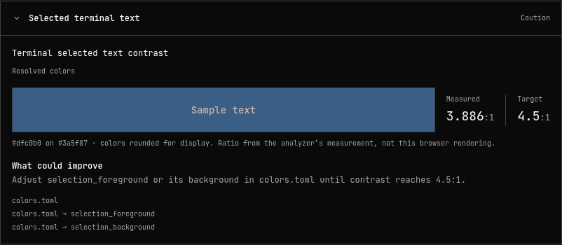
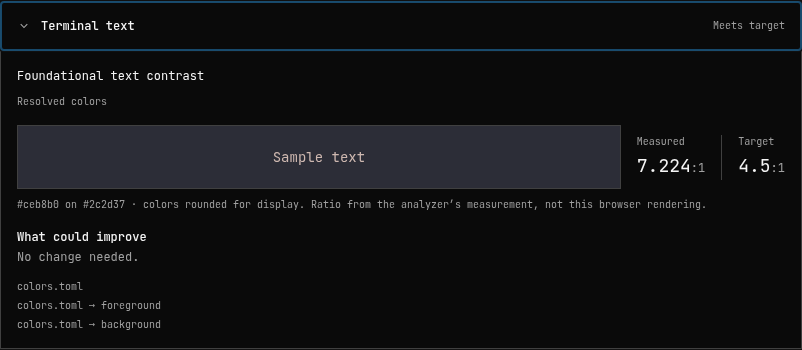
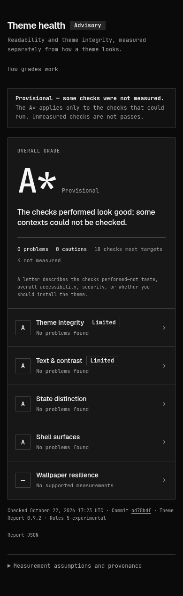

# Advisory Theme Report integration

This is a read-only presentation of optional `health` data published by `omacom/omarchy-theme-registry`. It does not score themes, invoke an analyzer, fetch theme repositories, change sorting, or participate in validation. Existing catalogs without this field continue to work.

## Presentation

- A muted 16px clipboard and letter beside GitHub stars link to the detail page's `#theme-health` anchor, escaping the gallery Turbo Frame. The letter and icon keep the same muted color on hover; keyboard focus has an outline.
- Only a valid report whose `commit` exactly matches the catalog theme's `commit` gets a letter. Provisional grades retain `*`. Missing, unsupported, malformed, ungraded and outdated reports have no current letter.
- The report card retains the five areas and the analyzer's letters, including capped grades. Both issues and passing checks expand to expose safe scalar measurements, targets, source keys, methodology and remediation. Passing checks stay behind a compact, collapsed group until requested. Color previews are illustrative displays of rounded evidence, not fresh browser measurements. OKLab fill distance is not presented as text contrast.
- Check times display in UTC using a non-mutating conversion, including reports supplied with numeric timezone offsets. The original timestamp remains unchanged in the shared frozen report and public JSON.
- `GET /themes/:slug/health` returns the current public report as JSON. Missing/outdated data is 404; it never triggers analysis.

The site intentionally has no grade filter, grade-based sorting, installation gate, artist notification, account, review score or popularity change.

## Contract

The publisher owns `packages/schema/src/theme-health.ts`: public advisory schema version 1. `ThemeHealth` validates the same bounded shape, ignores unsupported/malformed reports, freezes a private copy and compares source commits. The regression fixture `test/fixtures/theme_health.json` is produced by the real registry projection of a native v2 analyzer fixture; it is not a rating of a listed theme.

Fields: schema version; theme and runtime commits; analyzer/ruleset/profile; input fingerprint and UTC check time; native overall state, grade, summary and grade-cap reasons; five category summaries; bounded findings with safe scalar evidence and source keys; measurement assumptions. Native absolute theme paths, watched paths, media grids, decoder internals and arbitrary evidence objects are not part of this public contract. Reports are limited to 96 KiB. No score is recalculated in Ruby.

The data is inline in the full catalog, which the existing process cache already shares. The CLI's `catalog.min.json` remains unchanged. This avoids request-time report fetches, another endpoint dependency or mutable per-theme caches.

The registry generates reports against one reviewed Omarchy revision in an isolated clean home with no network, credentials or desktop IPC. It reuses results only while theme commit, renderer, analyzer, decoder identities and projection implementation still match. The website must not infer a current grade from old reports or from a numeric score alone.

## Coordinated rollout

1. Land the website consumer: old catalogs show "Not checked yet" and have no gallery grades. The website needs no analyzer dependency or background job.
2. Land the registry producer and optional build preparation. It adds the advisory field without changing listing validation or the compact CLI catalog.
3. Verify a real catalog refresh and the exact commit on the theme page. No theme entry edits or individual grade submissions are needed.

Updating the runtime or analyzer is a reviewed pin change, not an automatic dependency upgrade. Profiles and experimental rule assumptions stay visible. Discovery filters, artist feedback, richer wallpaper evidence and historical comparison are follow-up work, not this contribution.

## Visual examples

These are cropped captures of the Rails UI using saved, sandbox-generated reports from October 22, 2026 for the exact theme commits shown. They are local integration examples, not current grades on the deployed marketplace. The pictured themes belong to the contributor. The screenshots are documentation only; the app never loads them.

### Gallery grades

The clipboard and letter sit beside GitHub stars. An asterisk marks a provisional report.

### Advisory report

The overall grade and five expandable areas retain their measured results, with source commit, check time and JSON below.

### Finding evidence

An expanded finding exposes the analyzer's measured ratio, target, suggested improvement and source keys.

Passing checks use the same evidence disclosure, nested under the compact "checks meet targets" group. This passing terminal check shows why no change is needed; keyboard focus is visible on its summary.

### Provisional report on mobile

At a 390px viewport, the report explicitly distinguishes an A* from complete measurement and keeps unmeasured areas visible.

## Checks

- `bin/rails test`: models, rendered pages, stale/limited/missing states, escaping, public JSON and unchanged ordering.
- `bundle exec rubocop` and `bundle exec brakeman`.
- Rendered desktop/mobile checks: muted grade alignment, Turbo navigation, native disclosures, responsive layout, light/dark and zoom. Run against a local registry catalog, not invented ratings.

## Clipboard attribution

The new `survey-line` path is from Remix Icon, Copyright 2017–2026 Remix Design, under the Remix Icon License v1.0. It is a functional report link, not a brand mark.

https://github.com/Remix-Design/RemixIcon/blob/master/icons/Document/survey-line.svg

https://github.com/Remix-Design/RemixIcon/blob/master/License
